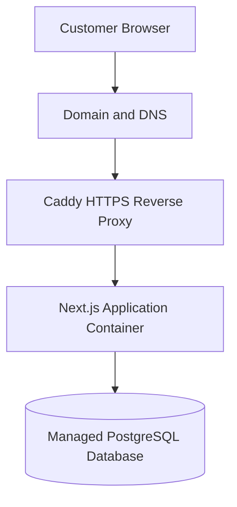
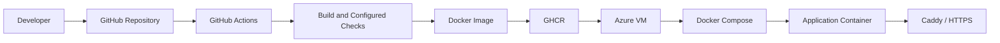

# Celiz LK — E-commerce Platform

Celiz LK is an e-commerce web application for a mobile-accessories business. The project combines product and order workflows with containerized deployment, CI/CD automation, cloud infrastructure, and basic operational monitoring.

> **Portfolio focus:** This repository demonstrates both application development and the practices used to build, deploy, monitor, and troubleshoot a web application. It is a personal/business project, not a claim of enterprise-scale production readiness.

**Live site:** [https://celiz.lk](https://celiz.lk)  <!-- Update or remove if the production URL changes or is not publicly accessible. -->

## Table of Contents

- [Overview](#overview)
- [Features](#features)
- [Technology Stack](#technology-stack)
- [Architecture](#architecture)
- [Repository Layout](#repository-layout)
- [Local Development](#local-development)
- [Environment Configuration](#environment-configuration)
- [Database Setup](#database-setup)
- [Docker](#docker)
- [CI/CD and Deployment](#cicd-and-deployment)
- [Monitoring and Operations](#monitoring-and-operations)
- [Troubleshooting](#troubleshooting)
- [Security Notes](#security-notes)
- [Known Limitations and Future Improvements](#known-limitations-and-future-improvements)

## Overview

Celiz LK is being developed as an online storefront for genuine mobile accessories. The application supports product discovery and purchase-related workflows, while the deployment setup provides a practical environment for working with containers, automated delivery, cloud hosting, and operational monitoring.

The infrastructure workflow uses Docker for packaging, GitHub Actions for automation, GitHub Container Registry (GHCR) for images, an Azure virtual machine for hosting, and Caddy as the HTTPS reverse proxy. Terraform is used to manage the infrastructure where configured. The deployed application connects to a managed PostgreSQL database.

## Features

### Storefront

- Product catalogue and product detail pages.
- Product pricing, stock availability, and promotional pricing where configured.
- Product categories and brands.
- Search and browsing features implemented by the application.
- Cart and checkout workflows.
- Order placement using the payment/confirmation methods supported by the current release, including cash on delivery and bank-transfer confirmation where enabled.
- Delivery rules based on supported delivery zones where configured.

### Administration

- Product and catalogue management.
- Product information such as slug, price, discounted price, stock quantity, category, brand, images, specifications, and SEO metadata.
- Order and inventory-related administration supported by the current application.

### DevOps and Operations

- Docker-based application packaging.
- Automated build and deployment workflow using GitHub Actions where configured.
- Container image publishing to GHCR.
- Azure VM hosting with Caddy handling HTTPS and reverse-proxy traffic.
- Infrastructure management with Terraform where configured.
- Application health endpoint and Docker health checks.
- External availability checks and alert notifications.
- Azure VM metrics and application/container logs for basic troubleshooting.

> Keep this feature list aligned with the code currently in the repository. Remove any item that is not implemented or enabled in the published version. Online card payments such as PayHere should not be described as supported unless they are implemented and tested.

## Technology Stack

| Area | Technologies |
|---|---|
| Web application | Next.js, React, TypeScript/JavaScript |
| Data access | Prisma ORM |
| Database | PostgreSQL in the deployed environment |
| Containers | Docker, Docker Compose |
| CI/CD | GitHub Actions |
| Container registry | GitHub Container Registry (GHCR) |
| Cloud hosting | Microsoft Azure Virtual Machine |
| Reverse proxy and HTTPS | Caddy |
| Infrastructure as Code | Terraform, where configured |
| Monitoring | Application health endpoint, Docker health checks, external uptime monitoring, Azure VM metrics, and logs |
| Version control | Git and GitHub |

The exact versions and commands are maintained in the project files (for example, `package.json`, the lockfile, `Dockerfile`, and Compose configuration).

## Architecture

### Request path



### Delivery workflow



The diagrams show the intended high-level workflow. Refer to the actual workflow files and infrastructure configuration for exact triggers, service names, networks, and deployment steps.

## Repository Layout

The layout below is illustrative; folders may differ in this project. Check the repository before relying on a path in a command or instruction.

```text
.
├── .github/workflows/   # CI/CD workflow definitions
├── prisma/              # Prisma schema and migration files, if used here
├── public/              # Static assets
├── src/ or app/         # Next.js application source
├── Dockerfile            # Application image build
├── docker-compose.yml    # Container runtime configuration (name may differ)
├── .dockerignore         # Files excluded from Docker build context
├── .gitignore            # Files excluded from version control
├── .env.example          # Example environment variables; no real secrets
├── package.json          # Scripts and dependencies
├── package-lock.json     # Locked npm dependency tree
└── README.md
```

Infrastructure managed in a separate repository should be linked here rather than copied into this repository without a reason.

## Local Development

### Prerequisites

- Git.
- A Node.js version compatible with the version declared by the project.
- npm.
- Access to a development database supported by the current Prisma schema.
- Docker and Docker Compose if you use the containerized local workflow.

### 1. Clone the repository

Replace the URL below with the actual public repository URL:

```bash
git clone https://github.com/<GITHUB_USERNAME>/<REPOSITORY_NAME>.git
cd <REPOSITORY_NAME>
```

### 2. Install dependencies

```bash
npm ci
```

### 3. Configure environment variables

Create a local `.env` file based on `.env.example` and supply development-only values. See [Environment Configuration](#environment-configuration).

### 4. Prepare the database

Use the project's documented Prisma/database scripts. If this repository uses Prisma migrations, apply the appropriate migration command for the development environment. Do not run development migration commands against the production database.

### 5. Start the development server

```bash
npm run dev
```

Open [http://localhost:3000](http://localhost:3000), unless the port is overridden by the local configuration.

### 6. Run checks

Review the scripts in `package.json` and run the checks configured by this project. Common examples are:

```bash
npm run lint
npm run build
```

Only run scripts that exist in `package.json`. If automated tests are configured, run the relevant test command as well.

## Environment Configuration

Keep environment-specific configuration outside source control. The `.env.example` file should document the variable names needed to start the application without containing production credentials.

Depending on the implementation, configuration may include:

| Variable | Purpose | Example guidance |
|---|---|---|
| `DATABASE_URL` | Database connection string | Use a local development database for local work; never commit a real connection string. |
| Authentication variables | Session, OAuth, or authentication provider configuration, if enabled | Use local/test credentials and follow the relevant provider's setup instructions. |
| Application URL variables | Public or internal application origin, if used | Set the correct local or deployment URL. |
| Storage/API variables | External service configuration, if used | Use placeholders in `.env.example` and keep secrets in the deployment secret store. |

Use the variable names actually read by the application. Do not copy production values into `.env.example`, screenshots, issue descriptions, or logs.

## Database Setup

The deployed application uses a managed PostgreSQL database. Local development should use an isolated development database with credentials that are not reused in production.

If Prisma is used by the current branch:

1. Review the Prisma schema and migration directory.
2. Confirm the database provider and connection variable expected by the project.
3. Use the repository's intended migration/generation scripts.
4. Verify that the application can connect to the development database.
5. Test backups and restores only in a separate development or staging database.

Use the existing scripts and configuration in the repository as the source of truth. The exact Prisma commands can differ depending on the Prisma version and project configuration.

## Docker

Docker packages the application and helps keep deployment behaviour consistent between environments.

Before running Compose commands, confirm the filename and service names in the repository. If the Compose file is `docker-compose.yml`, common commands include:

```bash
# Validate the Compose configuration
docker compose -f docker-compose.yml config

# Build the configured images (if a build section is present)
docker compose -f docker-compose.yml build

# Start services in the background
docker compose -f docker-compose.yml up -d

# Inspect service/container status
docker compose -f docker-compose.yml ps

# Review application logs (replace <service> with the real service name)
docker compose -f docker-compose.yml logs --tail=100 <service>

# Stop services

docker compose -f docker-compose.yml down
```

If the project pulls a pre-built GHCR image instead of building locally, use the workflow documented by the actual Compose configuration. Do not delete persistent database volumes as part of routine troubleshooting.

## CI/CD and Deployment

The deployment workflow is designed to make application delivery repeatable.

At a high level:

1. Code changes are pushed to the configured GitHub branch.
2. GitHub Actions runs the checks configured in the workflow.
3. The workflow builds a Docker image.
4. The image is published to GitHub Container Registry (GHCR), using repository secrets or permissions configured for the workflow.
5. The Azure VM pulls the intended image and starts or updates the application using Docker Compose.
6. Caddy routes HTTPS traffic to the application container.
7. The deployed health endpoint and external availability monitor are used to verify service availability.

The precise trigger, image tag, authentication method, and deployment commands are defined by the workflow and deployment files. Review `.github/workflows/` and the Compose configuration for the exact implementation.

### Infrastructure as Code

Terraform is used for infrastructure resources managed through the project's Terraform configuration. Review the Terraform repository and its README for the resource list, state configuration, variables, and apply procedure. Never commit Terraform state files or secret variable values to a public repository.

### Deployment safety

- Keep production credentials in GitHub/Azure secrets or the appropriate secret store.
- Avoid using mutable image tags as the sole means of identifying a release; record the actual tag or digest used for deployment.
- Verify the health check after deployment.
- Keep a documented recovery/rollback procedure.
- Avoid experimenting directly on production when a staging or local environment is sufficient.

## Monitoring and Operations

Monitoring is intended to distinguish public availability issues from application, container, and infrastructure issues.

### 1. External availability

An external uptime monitor checks the public homepage and the application's health endpoint over HTTPS. Notifications are configured for outages and recovery.

- Homepage check: verifies that the public site responds.
- Health check: queries `/api/health` and expects a successful HTTP response when the application and its database check are healthy.

An HTTP check does not prove that every product, cart, checkout, or order workflow is functioning. Important user journeys should also be tested separately.

### 2. Application health endpoint

The health endpoint is available at:

```text
/api/health
```

When healthy, it should return HTTP `200`. When a required dependency such as the database is unavailable, it should return a failure status (for example, HTTP `503`) without exposing connection strings or internal error details.

The endpoint's exact checks and response body are defined by the route handler in the repository. If its behaviour changes, update this documentation to match.

### 3. Docker health check

Docker Compose checks the application health endpoint from inside the container and reports the container's health state. A health check reporting `unhealthy` is a diagnostic signal; it does not automatically guarantee that Docker restarts the container.

Inspect status and logs with commands such as:

```bash
docker compose ps
docker compose logs --since=30m <application-service>
```

### 4. Azure VM metrics

Azure Monitor metrics provide host-level visibility into resources such as CPU, network traffic, and disk activity. Use the Azure portal's VM **Monitoring → Metrics** view to inspect trends and investigate possible resource pressure.

Host-level metrics are different from guest filesystem capacity and application-level metrics. For filesystem usage and memory, inspect the Linux VM directly when appropriate:

```bash
df -h
free -h
uptime
docker stats
```

### 5. Logs and incident investigation

Useful diagnostic sources include:

- Application/container logs.
- Caddy reverse-proxy logs.
- Docker container status and health state.
- Azure VM metrics.
- External monitor incident and recovery notifications.

A practical investigation sequence for an unavailable website is:

1. Confirm the external alert and check whether the homepage and health endpoint both fail.
2. Verify DNS and HTTPS reachability.
3. Check the Azure VM status and resource usage.
4. Inspect Docker Compose service status.
5. Review application and Caddy logs.
6. Check database connectivity where relevant.
7. Apply the smallest safe fix, then verify the homepage and health endpoint recover.
8. Record the cause, fix, and any follow-up action in an incident note or runbook.

## Troubleshooting

| Symptom | Checks to perform |
|---|---|
| Application fails to start | Review application logs, environment variables, build output, and container status. |
| `/api/health` returns an error | Check route-handler logs, database availability, credentials/configuration, and network access. |
| Container is `unhealthy` | Confirm the health-check URL and internal port, then inspect container logs. |
| Website cannot be reached | Check DNS, HTTPS/TLS, VM status, network rules, Caddy status, and application status. |
| Database connection fails | Verify the connection variable, database status, firewall/network access, TLS requirements, and database permissions. |
| CI/CD workflow fails | Review the failed GitHub Actions step, build output, registry permissions, image tags, and deployment logs. |
| Server disk usage is high | Check `df -h`, identify large logs/images safely, and confirm backups before removing anything. |
| A deployment introduces a fault | Use the documented prior working image/release and rollback procedure; verify the health check after recovery. |

Never paste unredacted production logs or secrets into public issues or commit them to the repository.

## Security Notes

- Never commit `.env` files containing credentials, tokens, or connection strings.
- Keep GitHub, Azure, database, and external-service credentials in the appropriate secret store.
- Apply least-privilege access to cloud resources and deployment identities.
- Expose only the network ports required by the application and administration workflow.
- Do not return stack traces, SQL errors, hostnames, or secrets from public health endpoints.
- Use test/staging environments for failure testing and database restore exercises.
- Review the Git history if a secret was ever committed. Removing it from the latest file does not remove it from earlier commits; revoke or rotate exposed credentials.

## Known Limitations and Future Improvements

Possible next steps, depending on project needs, include:

- Automated tests for important customer journeys and APIs.
- Structured application logs and centralized log retention.
- More detailed dashboards and alert thresholds for infrastructure metrics.
- Automated post-deployment smoke tests and a documented rollback workflow.
- Dependency and container image vulnerability scanning.
- Accessibility, performance, and security testing.

These are potential improvements, not claims that the functionality is already implemented.

## Project Status

This is an actively developed e-commerce and DevOps portfolio project. For the most accurate state of the implementation, refer to the source code, workflow files, deployment configuration, and recent repository commits.

## Contact

For questions about the project, use the contact information available on the linked GitHub profile or Celiz LK's official channels.
