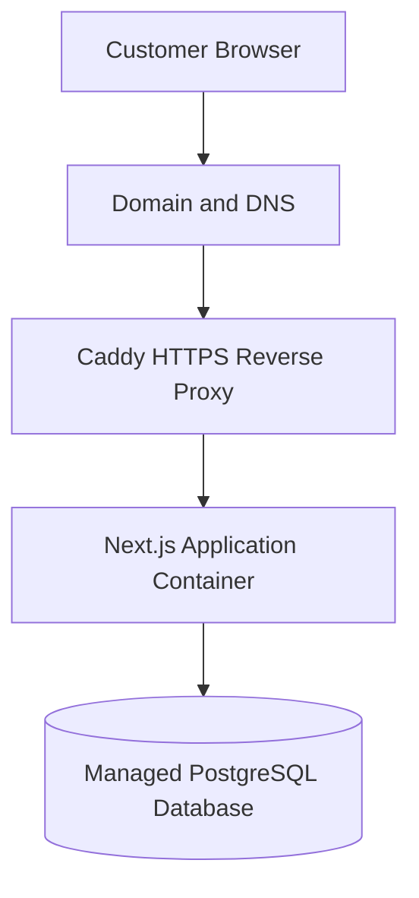
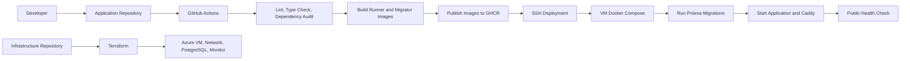

# Celiz LK — E-commerce Platform

Celiz LK is a live e-commerce web application for a mobile-accessories business. The production deployment is automated with GitHub Actions, Docker, GHCR, and SSH; it runs on Azure with Caddy in front of the application and a managed PostgreSQL database.

- **Live site:** <https://celizlk.duckdns.org/>
- **Application and CI/CD repository:** <https://github.com/Thiranjshan/CelizLK>
- **Infrastructure as Code repository:** <https://github.com/Thiranjshan/celizlk-infra>

## Table of Contents

- [Overview](#overview)
- [Repositories and Deployment Scope](#repositories-and-deployment-scope)
- [Features](#features)
- [Technology Stack](#technology-stack)
- [Architecture](#architecture)
- [Repository Layout](#repository-layout)
- [Local Development](#local-development)
- [Environment Configuration](#environment-configuration)
- [Database Setup](#database-setup)
- [Docker](#docker)
- [CI/CD and Deployment](#cicd-and-deployment)
- [Monitoring and Operations](#monitoring-and-operations)
- [Troubleshooting](#troubleshooting)
- [Security Notes](#security-notes)
- [Known Limitations and Future Improvements](#known-limitations-and-future-improvements)

## Overview

Celiz LK is a deployed e-commerce storefront for mobile accessories. This repository contains the Next.js application, its Docker image definitions, database schema and migrations, and the GitHub Actions CI/CD workflow. The companion infrastructure repository contains Terraform for the Azure resources. The production VM is configured to run the application and Caddy containers, and the deployed Caddy reverse proxy serves the public site over HTTPS.

## Repositories and Deployment Scope

| Repository | Contents |
| --- | --- |
| [CelizLK application](https://github.com/Thiranjshan/CelizLK) | Next.js storefront and admin application, Prisma schema/migrations, Docker `runner` and `migrator` targets, and the GitHub Actions CI/CD workflow. |
| [celizlk-infra](https://github.com/Thiranjshan/celizlk-infra) | Terraform configuration for the existing Azure deployment: Ubuntu 22.04 Linux VM (`Standard_B2ats_v2`), virtual network/subnet, public IP and network security group, managed OS disk, PostgreSQL Flexible Server (`B_Standard_B1ms`, 7-day backup retention), and Azure Monitor agent/data collection resources. |

The production deployment and Caddy reverse-proxy configuration are implemented and running. The VM's Docker Compose project and Caddy runtime configuration are configured on the deployment host; they are not files in either repository. Terraform state is currently local and is not committed. The infrastructure repository documents importing the existing Azure resources and checking for drift with `terraform plan`.

The Terraform network security group currently defines public inbound rules for SSH (`22`), HTTP (`80`), and HTTPS (`443`). Restrict SSH to trusted source addresses when managing the Azure network configuration.

## Features

### Storefront

- Product catalogue and product detail pages.
- Product pricing, stock availability, and promotional pricing where configured.
- Product categories and brands.
- Search and browsing features implemented by the application.
- Cart and checkout workflows.
- Order placement with cash on delivery or bank transfer. PayHere card payments are not available in the current checkout.
- Delivery fees and payment instructions managed through store settings.

### Administration

- Product and catalogue management.
- Product information such as slug, price, discounted price, stock quantity, category, brand, images, specifications, and SEO metadata.
- Order, inventory, customer, delivery-zone, merchandising, and store-settings administration.

## Screenshots

### Celiz LK Storefront


### Product Listing


### Admin Dashboard


### CI/CD Pipeline


### Monitoring


### DevOps and Operations

- Docker-based application packaging.
- Automated build and deployment workflow using GitHub Actions.
- Container image publishing to GHCR.
- Azure Linux VM hosting the application and Caddy containers; Caddy handles HTTPS and reverse-proxy traffic.
- Azure resources managed with Terraform in the companion infrastructure repository.
- Application health endpoint and Docker health checks.
- Azure Monitor Linux agent and data collection configuration; application/container logs are available on the VM.
- A post-deployment HTTPS health check in GitHub Actions.

## Technology Stack

| Area                    | Technologies                                                                                              |
| ----------------------- | --------------------------------------------------------------------------------------------------------- |
| Web application         | Next.js 16 App Router, React 19, TypeScript 5                                                             |
| Data access             | Prisma ORM 6                                                                                                |
| Database                | PostgreSQL                                                                                                |
| Containers              | Docker; Docker Compose is used by the deployment host                                                     |
| CI/CD                   | GitHub Actions                                                                                            |
| Container registry      | GitHub Container Registry (GHCR)                                                                          |
| Cloud hosting           | Azure Linux Virtual Machine and Azure Database for PostgreSQL Flexible Server                              |
| Reverse proxy and HTTPS | Caddy                                                                                                     |
| Infrastructure as Code  | Terraform in [celizlk-infra](https://github.com/Thiranjshan/celizlk-infra)                                 |
| Monitoring              | Application health endpoint, Docker health checks, Azure Monitor agent/data collection, and deployment health probe |
| Version control         | Git and GitHub                                                                                            |

Dependency versions are recorded in `package.json` and `package-lock.json`. The application repository contains the `Dockerfile` and CI/CD workflow. Compose and Caddy runtime configuration are on the deployed VM rather than checked into these repositories.

## Architecture

### Request path



### Delivery workflow



The request path represents the running production topology. The delivery workflow is implemented in `.github/workflows/ci-cd.yml`; Terraform for Azure is maintained in [celizlk-infra](https://github.com/Thiranjshan/celizlk-infra). The VM's Compose and Caddy runtime configuration is deployed on the host and is not tracked in either repository.

## Repository Layout

```text
.
├── app/                    # App Router pages and API routes
│   ├── admin/              # Admin screens
│   ├── api/                # API handlers, including /api/health
│   ├── checkout/           # Checkout flow
│   └── ...                 # Storefront, account, and information pages
├── components/             # Shared UI
├── lib/                    # Auth, order, database, and store logic
├── prisma/
│   ├── migrations/         # PostgreSQL migrations
│   ├── schema.prisma       # Data model
│   └── seed.ts             # Local demo-data seed
├── public/                 # Static assets and upload directory
├── tests/                  # Automated tests
├── .github/workflows/      # CI/CD workflow
├── Dockerfile              # runner and migrator image targets
├── .dockerignore
├── .env.example
├── package.json
├── package-lock.json
└── next.config.ts
```

## Local Development

### Prerequisites

- Git.
- Node.js 22 and npm (the Docker image and CI workflow use Node.js 22).
- A PostgreSQL development database.
- Docker only if building or running the container image. The production Compose project is on the deployment VM and is not included here.

### 1. Clone the repository

```bash
git clone https://github.com/Thiranjshan/CelizLK.git
cd CelizLK
```

### 2. Install dependencies

```bash
npm ci
```

### 3. Configure environment variables

Create `.env` from `.env.example`, replace `DATABASE_URL` with a PostgreSQL development connection string, and configure development-only secrets. Prisma CLI commands use `.env`; Next.js also loads it. The SQLite-looking value in the current example file is a legacy placeholder and is not compatible with the PostgreSQL Prisma schema. See [Environment Configuration](#environment-configuration).

### 4. Prepare the database

Apply the Prisma migrations and generate the client:

```bash
npx prisma migrate dev
npx prisma generate
```

One migration enables PostgreSQL's `pg_trgm` extension for product-name search. The database role must be able to create it, or the database administrator must provision it first. Never run `migrate dev` against production.

The optional `npx prisma db seed` command runs `prisma/seed.ts`, which deletes and recreates demo data. Use it only with a disposable local database; `ALLOW_DESTRUCTIVE_SEED=true` bypasses its safeguard.

### 5. Start the development server

```bash
npm run dev
```

Open [http://localhost:3000](http://localhost:3000), unless the port is overridden by the local configuration.

### 6. Run checks

Run the available checks:

```bash
npm run lint
npx tsc --noEmit
npm test
npm run build
```

`npm test` runs `tests/*.test.ts` using Node's test runner and `tsx`. Tests requiring Prisma need a dedicated test database with the migrations applied.

## Environment Configuration

Keep environment-specific configuration outside source control. `.env.example` currently lists these values:

| Variable | Purpose |
| --- | --- |
| `DATABASE_URL` | PostgreSQL connection used by Prisma. |
| `JWT_ACCESS_SECRET` | Customer access-token signing key. |
| `ADMIN_JWT_SECRET` | Separate admin-token signing key; production requires at least 32 characters. |
| `DELIVERY_FEE_LKR`, `NEXT_PUBLIC_DELIVERY_FEE_LKR` | Legacy example entries; the application currently does not read these values. |
| `ALLOW_DESTRUCTIVE_SEED` | Optional seed-script override. Set to `true` only when intentionally resetting a disposable local database. |

Google OAuth is optional and reads `GOOGLE_CLIENT_ID`, `GOOGLE_CLIENT_SECRET`, `GOOGLE_REDIRECT_URI`, and optionally `APP_URL`. `CORS_ALLOWED_ORIGINS` optionally configures the allowed origins. `NEXT_PUBLIC_SITE_URL` or `SITE_URL` sets the canonical URL used by sitemap and robots metadata; without either, production defaults to `https://celiz.lk`, so set one if the deployed public domain differs. `SEARCH_MODE=legacy` selects the legacy search implementation.

Use development-only secrets locally and keep production values in the deployment secret store. Do not commit real credentials or connection strings.

## Database Setup

The Prisma schema at `prisma/schema.prisma` uses PostgreSQL and `DATABASE_URL`. Migration SQL is versioned in `prisma/migrations/`. Use `npx prisma migrate dev` locally and `npx prisma migrate deploy` for deployment. Back up production before schema changes; do not run development migrations or the demo seed against production.

## Docker

The repository includes a multi-stage `Dockerfile` with two final targets:

- `runner` serves the Next.js standalone build on port `3000` as a non-root user.
- `migrator` runs `prisma migrate deploy` for deployment migrations.

Build the application image from the repository root:

```bash
docker build --target runner -t celiz-lk:local .
```

The runner image has a Docker `HEALTHCHECK` that calls `/api/health` every 30 seconds, with a 5-second timeout, a 60-second startup grace period, and 3 retries. This endpoint checks the app and its database connection.

```bash
docker ps
docker inspect --format '{{json .State.Health}}' <container-name-or-id>
docker logs --tail=100 <container-name-or-id>
```

The Compose file used by deployment is not included in this repository. The GitHub Actions deployment expects a Compose project on the VM under `~/app`; its services must use the published image and provide runtime environment variables. Compose inherits the image health check unless the service configuration overrides or disables it. Docker reports `unhealthy` but does not restart a container solely because of that state.

## CI/CD and Deployment

The implemented workflow in `.github/workflows/ci-cd.yml` runs on pushes and pull requests to `main` and manual dispatch. Its test job installs dependencies, generates Prisma Client, runs ESLint and TypeScript checks, and runs `npm audit --audit-level=critical` (the audit step is configured to continue if it fails). It does not currently run `npm test`.

On pushes to `main`, the workflow builds and publishes the `runner` image with `latest` and commit-SHA tags, and the `migrator` image with `migrator` and `migrator-<sha>` tags, to GHCR. It connects to the VM over SSH using the `VM_HOST`, `VM_USER`, and `VM_SSH_KEY` GitHub Actions secrets; in `~/app`, it pulls the Compose `tools` profile, runs the migration service, starts the services, and prunes unused images. The workflow then probes `https://celizlk.duckdns.org/api/health`, retrying before it fails the deployment job.

The deployment pipeline and production Caddy configuration are implemented. The Compose project and runtime environment are configured on the VM rather than tracked in the application repository; Azure resource definitions are tracked in [celizlk-infra](https://github.com/Thiranjshan/celizlk-infra). The `runner` image includes a Docker health check, and deployment is verified with the public application health endpoint.

## Monitoring and Operations

The deployment combines an application/database health endpoint, the Docker image health check, an HTTPS health probe after each deployment, and Azure Monitor data collection for VM metrics. These checks cover different layers; none alone validates all storefront workflows.

### 1. Post-deployment availability probe

The CI/CD workflow performs a post-deployment HTTPS request to the health endpoint. This is a deployment-time probe, not a continuous external uptime monitor.

An HTTP health check does not prove that every product, cart, checkout, or order workflow is functioning. Important user journeys need separate tests.

### 2. Application health endpoint

The health endpoint is available at:

```text
/api/health
```

The route checks the Node process and runs `SELECT 1` against PostgreSQL with a 3-second database timeout. It returns HTTP `200` when healthy and `503` when the database check fails. The public response avoids internal database errors; details are logged by the server.

The route returns JSON with an overall status and individual app/database checks. Its exact response shape is defined in `app/api/health/route.ts`.

### 3. Docker health check

The runner image's Docker `HEALTHCHECK` probes `/api/health` inside the container. Compose displays this image-level health state unless its service configuration overrides or disables the check. An `unhealthy` state is diagnostic; Docker does not restart a container solely because of it.

Inspect health and logs with:

```bash
docker compose ps
docker compose logs --since=30m <application-service>
docker inspect --format '{{json .State.Health}}' <container-name-or-id>
```

The Compose commands require the deployment-host Compose project; no Compose file is checked in here.

### 4. Azure Monitor and VM metrics

The infrastructure Terraform configures the Azure Monitor Linux agent and a data collection rule for VM performance metrics. Use the Azure portal's VM **Monitoring → Metrics** view to inspect available metrics and investigate resource pressure. The Terraform also defines an action group; an action group alone is not an alert rule or continuous website monitor.

Host-level metrics are different from guest filesystem capacity and application-level metrics. For filesystem usage and memory, inspect the Linux VM directly when appropriate:

```bash
df -h
free -h
uptime
docker stats
```

### 5. Logs and incident investigation

Useful diagnostic sources include:

- Application/container logs.
- Caddy reverse-proxy logs.
- Docker container status and health state.
- Azure VM metrics.
- GitHub Actions deployment and health-check results.

A practical investigation sequence for an unavailable website is:

1. Open the homepage and health endpoint to establish whether the issue affects the public site, the health probe, or both.
2. Verify DNS and HTTPS reachability.
3. Check the Azure VM status and resource usage.
4. Inspect Docker Compose service status.
5. Review application and Caddy logs.
6. Check database connectivity where relevant.
7. Apply the smallest safe fix, then verify the homepage and health endpoint recover.
8. Record the cause, fix, and any follow-up action in an incident note or runbook.

## Troubleshooting

| Symptom                         | Checks to perform                                                                                                     |
| ------------------------------- | --------------------------------------------------------------------------------------------------------------------- |
| Application fails to start      | Review application logs, environment variables, build output, and container status.                                   |
| `/api/health` returns an error  | Check route-handler logs, database availability, credentials/configuration, and network access.                       |
| Container is `unhealthy`        | Confirm the health-check URL and internal port, then inspect container logs.                                          |
| Website cannot be reached       | Check DNS, HTTPS/TLS, VM status, network rules, Caddy status, and application status.                                 |
| Database connection fails       | Verify the connection variable, database status, firewall/network access, TLS requirements, and database permissions. |
| CI/CD workflow fails            | Review the failed GitHub Actions step, build output, registry permissions, image tags, and deployment logs.           |
| Server disk usage is high       | Check `df -h`, identify large logs/images safely, and confirm backups before removing anything.                       |
| A deployment introduces a fault | Review the failed deployment and health-check logs. No automatic rollback is configured; recover using the deployment host's Compose configuration and a known-good image tag, then verify health. |

Never paste unredacted production logs or secrets into public issues or commit them to the repository.

## Security Notes

- Never commit `.env` files containing credentials, tokens, or connection strings.
- Keep GitHub, Azure, database, and external-service credentials in the appropriate secret store.
- Apply least-privilege access to cloud resources and deployment identities.
- Expose only the network ports required by the application and administration workflow.
- Do not return stack traces, SQL errors, hostnames, or secrets from public health endpoints.
- Use test/staging environments for failure testing and database restore exercises.
- Review the Git history if a secret was ever committed. Removing it from the latest file does not remove it from earlier commits; revoke or rotate exposed credentials.

## Known Limitations and Future Improvements

Possible next steps, depending on project needs, include:

- Automated tests for important customer journeys and APIs (the current CI test job does not run `npm test`).
- Structured application logs and centralized log retention.
- Explicit Azure metric alert rules and continuous external uptime monitoring.
- Automated storefront smoke tests and a documented rollback workflow (the current pipeline probes `/api/health` after deployment).
- Dependency and container image vulnerability scanning.
- Accessibility, performance, and security testing.

These are potential improvements, not claims that the functionality is already implemented. Azure infrastructure is tracked in [celizlk-infra](https://github.com/Thiranjshan/celizlk-infra); the production VM's Compose and Caddy runtime configuration is deployed on the host and is not checked into either repository.

## Project Status

The application is deployed at the live site above, and its CI/CD pipeline and production deployment are implemented. For application and deployment automation, see this repository; for Azure resource definitions, see [celizlk-infra](https://github.com/Thiranjshan/celizlk-infra).
