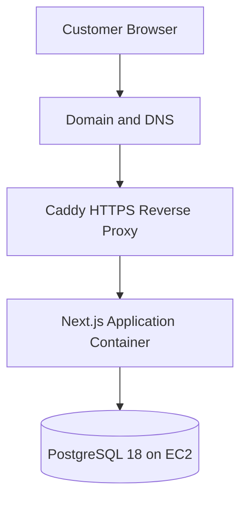

# Celiz LK — E-commerce Platform

Celiz LK is a live e-commerce web application for a mobile-accessories business.

- **Live site:** <https://celizlk.store/>
- **Application and CI/CD repository:** <https://github.com/Thiranjshan/CelizLK>
- **AWS infrastructure configuration:** [`infra/aws/`](infra/aws/)

## Table of Contents

- [Overview](#overview)
- [Repositories and Deployment Scope](#repositories-and-deployment-scope)
- [Features](#features)
- [Technology Stack](#technology-stack)
- [Architecture](#architecture)
- [Repository Layout](#repository-layout)
- [Local Development](#local-development)
- [Environment Configuration](#environment-configuration)
- [Database Setup](#database-setup)
- [Docker](#docker)
- [CI/CD and Deployment](#cicd-and-deployment)
- [AWS Migration Runbook](infra/aws/README.md)
- [Monitoring and Operations](#monitoring-and-operations)
- [Troubleshooting](#troubleshooting)
- [Security Notes](#security-notes)
- [Known Limitations and Future Improvements](#known-limitations-and-future-improvements)
- [Project Status](#project-status)

## Overview

Celiz LK is a deployed e-commerce storefront for mobile accessories at [celizlk.store](https://celizlk.store/). This repository contains the Next.js application, Docker image definitions, database schema and migrations, GitHub Actions workflow, and the AWS Terraform and runtime/backup configuration. AWS files are prepared configuration only; provisioning, data restore, and cutover are pending.

## Repositories and Deployment Scope

| Repository | Contents |
| --- | --- |
| [CelizLK application](https://github.com/Thiranjshan/CelizLK) | Next.js storefront and admin application, Prisma schema/migrations, Docker `runner` and `migrator` targets, CI/CD, and prepared AWS configuration under `infra/aws/`. |
| AWS deployment target | Prepared configuration: one EC2 instance for the application, PostgreSQL 18, and Caddy, with persistent encrypted storage, automated backups, and SSM-based deployment. It is not provisioned yet. |

AWS Terraform, Compose, Caddy, role initialization, and backup scripts are maintained in this repository; they do not depend on a separate infrastructure repository. AWS provisioning, DNS changes, data restore, and cutover have not been performed.

## Features

### Storefront

- Product catalogue and product detail pages.
- Product pricing, stock availability, and promotional pricing where configured.
- Product categories and brands.
- Search and browsing features implemented by the application.
- Cart and checkout workflows.
- Customer accounts, saved addresses, and order history.
- Order placement with cash on delivery or bank transfer. Bank-transfer proof and payment verification are supported; PayHere/card checkout is not currently implemented.
- Delivery fees and payment instructions managed through store settings.

### Administration

- Product and catalogue management.
- Product information such as slug, price, discounted price, stock quantity, category, brand, images, specifications, and SEO metadata.
- Order and payment management, inventory, customers, delivery zones, coupons, reviews, staff, featured categories, hero banners, and store settings.

## Screenshots

### Celiz LK Storefront


### Product Listing


### Admin Dashboard


### CI/CD Pipeline


### Monitoring


### DevOps and Operations

- Docker-based application packaging.
- Automated build and deployment workflow using GitHub Actions.
- Container image publishing to GHCR.
- Prepared deployment target (not provisioned): one AWS EC2 instance running the application, PostgreSQL 18, and Caddy through Docker Compose.
- AWS Terraform state: separate versioned/encrypted S3 bucket with S3-native state locking.
- Application health endpoint and Docker health checks.
- AWS target backup timers and deployment health checks are documented in the runbook.

## Technology Stack

| Area                    | Technologies                                                                                              |
| ----------------------- | --------------------------------------------------------------------------------------------------------- |
| Web application         | Next.js 16 App Router, React 19, TypeScript 5                                                             |
| Data access             | Prisma ORM 6                                                                                                |
| Database                | PostgreSQL                                                                                                |
| Containers              | Docker; Docker Compose is used by the deployment host                                                     |
| CI/CD                   | GitHub Actions                                                                                            |
| Container registry      | GitHub Container Registry (GHCR)                                                                          |
| Cloud hosting           | AWS EC2 target (prepared; not yet provisioned)                                                            |
| Reverse proxy and HTTPS | Caddy                                                                                                     |
| Infrastructure as Code  | Terraform under `infra/aws/` for the prepared AWS target                                                  |
| Monitoring              | Application health endpoint, Docker health checks, AWS Systems Manager command results, and scheduled backup timers |
| Version control         | Git and GitHub                                                                                            |

Dependency versions are recorded in `package.json` and `package-lock.json`. AWS Compose and Caddy runtime configuration are tracked in `infra/aws/runtime/`; production secrets remain on the host and are not committed.

## Architecture

### Prepared AWS target request path (not live yet)



### Delivery workflow

```mermaid
flowchart LR
    Developer[Developer] --> AppRepo[Application Repository]
    AppRepo --> Actions[GitHub Actions]
    Actions --> Checks[Lint, Type Check, Tests, Dependency Audit]
    Checks --> Build[Build Runner and Migrator Images]
    Build --> Registry[Publish SHA-tagged Images to GHCR]
    Registry --> Deploy[GitHub OIDC and SSM]
    Deploy --> Compose[EC2 Docker Compose]
    Compose --> Migrate[Run Prisma Migrations]
    Migrate --> Start[Start Application and Caddy]
    Start --> Verify[Container and Database Health Check]
    Terraform[AWS Terraform Apply] -. separate manual workflow .-> AWS[EC2, EBS, EIP, Network]
```



The AWS diagram is the prepared target, not a claim that AWS is live. The current production service at celizlk.store remains authoritative until the AWS target is provisioned, restored, verified, and cut over. App image deployment and Terraform provisioning are separate: pushes do not run Terraform.

## Repository Layout

```text
.
├── app/                    # App Router pages and API routes
│   ├── admin/              # Admin screens
│   ├── api/                # API handlers, including /api/health
│   ├── checkout/           # Checkout flow
│   └── ...                 # Storefront, account, and information pages
├── components/             # Shared UI
├── lib/                    # Auth, order, database, and store logic
├── prisma/
│   ├── migrations/         # PostgreSQL migrations
│   ├── schema.prisma       # Data model
│   └── seed.ts             # Local demo-data seed
├── public/                 # Static assets and upload directory
├── tests/                  # Automated tests
├── .github/workflows/      # CI/CD workflow
├── Dockerfile              # runner and migrator image targets
├── infra/aws/              # AWS Terraform, Compose, Caddy, bootstrap, and runbook
├── scripts/aws/            # EC2 deployment and server-side backup scripts
├── scripts/windows/        # Checksum-verifying local backup downloader
├── .dockerignore
├── .env.example
├── package.json
├── package-lock.json
└── next.config.ts
```

## Local Development

### Prerequisites

- Git.
- Node.js 22 and npm (the Docker image and CI workflow use Node.js 22).
- A PostgreSQL development database.
- Docker only if building or running the container image. The AWS Compose project is tracked under `infra/aws/runtime/`; the existing production Compose configuration is managed separately from this repository.

### 1. Clone the repository

```bash
git clone https://github.com/Thiranjshan/CelizLK.git
cd CelizLK
```

### 2. Install dependencies

```bash
npm ci
```

### 3. Configure environment variables

Create `.env` from `.env.example`, replace `DATABASE_URL` with a PostgreSQL development connection string, and configure development-only secrets. Prisma CLI commands use `.env`; Next.js also loads it. See [Environment Configuration](#environment-configuration).

### 4. Prepare the database

Apply the Prisma migrations and generate the client:

```bash
npx prisma migrate dev
npx prisma generate
```

One migration enables PostgreSQL's `pg_trgm` extension for product-name search. The database role must be able to create it, or the database administrator must provision it first. Never run `migrate dev` against production.

The optional `npx prisma db seed` command runs `prisma/seed.ts`, which deletes and recreates demo data. Use it only with a disposable local database; `ALLOW_DESTRUCTIVE_SEED=true` bypasses its safeguard.

### 5. Start the development server

```bash
npm run dev
```

Open [http://localhost:3000](http://localhost:3000), unless the port is overridden by the local configuration.

### 6. Run checks

Run the available checks:

```bash
npm run lint
npx tsc --noEmit
npm test
npm run build
```

`npm test` runs `tests/*.test.ts` using Node's test runner and `tsx`. Tests requiring Prisma need a dedicated test database with the migrations applied.

## Environment Configuration

Keep environment-specific configuration outside source control. `.env.example` lists local-development values. AWS deployment templates are in `infra/aws/runtime/*.env.example`; copy and populate them on the host without committing the completed files. The AWS examples use `celizlk.store`.

| Variable | Purpose |
| --- | --- |
| `DATABASE_URL` | PostgreSQL connection used by Prisma. |
| `JWT_ACCESS_SECRET` | Customer access-token signing key. |
| `ADMIN_JWT_SECRET` | Separate admin-token signing key; production requires at least 32 characters. |
| `APP_URL`, `SITE_URL`, `NEXT_PUBLIC_SITE_URL` | Optional OAuth callback base and canonical public URLs; keep production values consistent with the chosen domain. |
| `CORS_ALLOWED_ORIGINS` | Optional comma-separated allowed web origins. |
| `GOOGLE_CLIENT_ID`, `GOOGLE_CLIENT_SECRET`, `GOOGLE_REDIRECT_URI` | Optional Google OAuth configuration. |
| `DELIVERY_FEE_LKR`, `NEXT_PUBLIC_DELIVERY_FEE_LKR` | Legacy example entries; the application currently does not read these values. |
| `ALLOW_DESTRUCTIVE_SEED` | Optional seed-script override. Set to `true` only when intentionally resetting a disposable local database. |

Google OAuth is optional. `NEXT_PUBLIC_SITE_URL` or `SITE_URL` sets the canonical URL used by sitemap and robots metadata; the production fallback is `https://celizlk.store`. `SEARCH_MODE=legacy` selects the legacy search implementation. The AWS Compose app and migrator use different PostgreSQL roles and connection strings. Bank-transfer instructions are read from persisted store settings; this repository does not currently configure SMTP/email or PayHere credentials.

Use development-only secrets locally and keep production values in the deployment secret store. Do not commit real credentials or connection strings.

## Database Setup

The Prisma schema at `prisma/schema.prisma` uses PostgreSQL and `DATABASE_URL`. Migration SQL is versioned in `prisma/migrations/`. Use `npx prisma migrate dev` locally and `npx prisma migrate deploy` for deployment. Back up production before schema changes; do not run development migrations or the demo seed against production.

## Docker

The repository includes a multi-stage `Dockerfile` with two final targets:

- `runner` serves the Next.js standalone build on port `3000` as a non-root user.
- `migrator` runs `prisma migrate deploy` for deployment migrations.

Build the application image from the repository root:

```bash
docker build --target runner -t celiz-lk:local .
```

The runner image has a Docker `HEALTHCHECK` that calls `/api/health` every 30 seconds, with a 5-second timeout, a 60-second startup grace period, and 3 retries. This endpoint checks the app and its database connection.

```bash
docker ps
docker inspect --format '{{json .State.Health}}' <container-name-or-id>
docker logs --tail=100 <container-name-or-id>
```

The prepared AWS Compose file is `infra/aws/runtime/compose.yaml`; it runs PostgreSQL 18, the runner/migrator images, and Caddy on one EC2 instance. PostgreSQL has no published host port and uses the persistent `/srv/celiz/postgres` directory. Uploaded files retain the existing host/container mapping `/srv/celiz/uploads:/app/public/uploads`; Caddy certificate state is also on the encrypted persistent disk. Production env files are host-only and must be created from the examples.

The app and migration roles are separate. The migration service runs `prisma migrate deploy` only; it does not reset or seed the restored data. PostgreSQL 18 stores its data under the versioned directory within the mounted `/var/lib/postgresql` root. Compose health-checks the database and application. Docker reports `unhealthy` but does not restart a container solely because of that state.

## CI/CD and Deployment

The workflow in `.github/workflows/ci-cd.yml` runs lint and TypeScript checks plus unit/integration tests against a disposable PostgreSQL 18 service. It applies the Prisma migrations and seeds test fixtures only in that ephemeral CI database; the destructive seed override is scoped to the fixture step and is never used for production deployment. The critical-severity dependency audit is non-blocking.

Successful main builds publish the runner and migrator images to GHCR using the full commit SHA. A serialized deploy job (enabled only when `AWS_DEPLOY_ENABLED=true`) assumes an AWS role through GitHub OIDC and invokes the EC2 deployment script using Systems Manager. Until AWS is provisioned and accepted, tests/builds run while AWS deployment is skipped; existing production resources and DNS are not changed. The EC2 script runs the matching migration image, updates Compose services, waits for the database-backed app health check, and retains the previous healthy image for recovery. It does not roll back a database migration. It prunes only unused container images older than seven days after a healthy deployment; it never prunes volumes or database/upload data.

The GitHub Actions repository variables are `AWS_DEPLOY_ENABLED`, `AWS_ROLE_ARN`, `AWS_REGION`, and `EC2_INSTANCE_ID`. The role ARN is a Terraform output; no long-lived AWS access key is needed in GitHub. EC2 has a separate root-only GHCR read token for pulling images. Application secrets are provisioned in protected files under `/srv/celiz/runtime/` and are not passed through Terraform or SSM. The AWS deployment is prepared, not live, until infrastructure, restore, verification, and owner-approved DNS cutover are complete. See the [AWS migration runbook](infra/aws/README.md).

## Monitoring and Operations

The prepared AWS target checks the app and PostgreSQL through `/api/health`, the Docker health state, and the status/output of the SSM deployment command. This is not a continuous external uptime monitor and does not prove all storefront flows.

### 1. Post-deployment availability probe

Before DNS cutover, the AWS deployment verifies the application from its container network; after cutover, verify HTTPS and the public health endpoint from an external client. This is a deployment-time check, not a continuous external uptime monitor.

An HTTP health check does not prove that every product, cart, checkout, or order workflow is functioning. Important user journeys need separate tests.

### 2. Application health endpoint

The health endpoint is available at:

```text
/api/health
```

The route checks the Node process and runs `SELECT 1` against PostgreSQL with a 3-second database timeout. It returns HTTP `200` when healthy and `503` when the database check fails. The public response avoids internal database errors; details are logged by the server.

The route returns JSON with an overall status and individual app/database checks. Its exact response shape is defined in `app/api/health/route.ts`.

### 3. Docker health check

The runner image's Docker `HEALTHCHECK` probes `/api/health` inside the container. Compose displays this image-level health state unless its service configuration overrides or disables the check. An `unhealthy` state is diagnostic; Docker does not restart a container solely because of it.

Inspect health and logs with:

```bash
docker compose ps
docker compose logs --since=30m <application-service>
docker inspect --format '{{json .State.Health}}' <container-name-or-id>
```

On the AWS host, the Compose project is `/srv/celiz/compose.yaml`.

### 4. Host and backup monitoring

Host-level metrics are different from guest filesystem capacity and application-level metrics. For filesystem usage and memory, inspect the Linux VM directly when appropriate:

```bash
df -h
free -h
uptime
docker stats
```

On AWS, use Systems Manager for host access and inspect the UTC backup timers/services with `systemctl list-timers 'celiz-backup-*'`, `systemctl status celiz-backup-postgres.service celiz-backup-uploads.service`, and `journalctl`. Server backups are stored on the same persistent disk; download and independently verify them regularly. See the [backup runbook](infra/aws/README.md#backup-download-restore-safety).

### 5. Logs and incident investigation

Useful diagnostic sources include:

- Application/container logs.
- Caddy reverse-proxy logs.
- Docker container status and health state.
- AWS EC2 metrics and Systems Manager command output.
- GitHub Actions deployment and health-check results.

A practical investigation sequence for an unavailable website is:

1. Open the homepage and health endpoint to establish whether the issue affects the public site, the health probe, or both.
2. Verify DNS and HTTPS reachability.
3. Check the AWS EC2 instance status and resource usage.
4. Inspect Docker Compose service status.
5. Review application and Caddy logs.
6. Check database connectivity where relevant.
7. Apply the smallest safe fix, then verify the homepage and health endpoint recover.
8. Record the cause, fix, and any follow-up action in an incident note or runbook.

## Troubleshooting

| Symptom                         | Checks to perform                                                                                                     |
| ------------------------------- | --------------------------------------------------------------------------------------------------------------------- |
| Application fails to start      | Review application logs, environment variables, build output, and container status.                                   |
| `/api/health` returns an error  | Check route-handler logs, database availability, credentials/configuration, and network access.                       |
| Container is `unhealthy`        | Confirm the health-check URL and internal port, then inspect container logs.                                          |
| Website cannot be reached       | Check DNS, HTTPS/TLS, the currently authoritative VM, network rules, Caddy status, and application status. |
| Database connection fails       | Verify the connection variable, database status, firewall/network access, TLS requirements, and database permissions. |
| CI/CD workflow fails            | Review the failed GitHub Actions step, build output, registry permissions, image tags, and deployment logs.           |
| Server disk usage is high       | Check `df -h`, identify large logs/images safely, and confirm backups before removing anything.                       |
| AWS deployment introduces a fault | Review the SSM output and Docker health/logs. The deploy script attempts an application-image rollback, but does not reverse database migrations; verify schema compatibility before rollback. |

Never paste unredacted production logs or secrets into public issues or commit them to the repository.

## Security Notes

- Never commit `.env` files containing credentials, tokens, or connection strings.
- Keep GitHub, AWS, database, and external-service credentials in the appropriate secret store.
- Apply least-privilege access to cloud resources and deployment identities.
- Expose only the network ports required by the application and administration workflow.
- Do not return stack traces, SQL errors, hostnames, or secrets from public health endpoints.
- Use test/staging environments for failure testing and database restore exercises.
- Review the Git history if a secret was ever committed. Removing it from the latest file does not remove it from earlier commits; revoke or rotate exposed credentials.

## Known Limitations and Future Improvements

Possible next steps, depending on project needs, include:

- Automated tests for important customer journeys and APIs beyond the existing automated test suite.
- Structured application logs and centralized log retention.
- AWS metric alert rules and continuous external uptime monitoring.
- Automated storefront smoke tests.
- Dependency and container image vulnerability scanning.
- Accessibility, performance, and security testing.

These are potential improvements, not claims that the functionality is already implemented. The prepared AWS Compose and Caddy runtime configuration is checked into this repository.

## Project Status

The application is live at the site above. The AWS deployment is prepared only and is not yet provisioned; see [infra/aws/README.md](infra/aws/README.md) for the staging, restore, and cutover gates.
